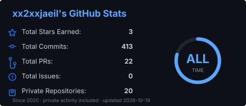
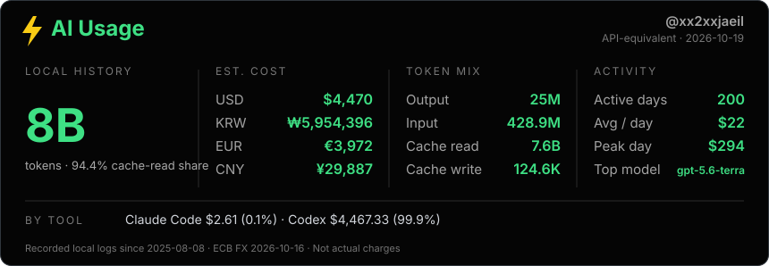

# Hi, I'm Jaeil 👋

I build developer tools with a focus on code quality and maintainability. 
AI can make coding faster, but developers still need to understand and verify what changed. 
I'm currently building [IntentPatch](https://github.com/xx2xxjaeil/intent-patch) to make that review easier.

## Featured project: IntentPatch

IntentPatch is an open-source CLI and GitHub Action that analyzes a Git diff for changes outside the expected scope, possible duplication, dependency changes, and downstream impact. Its core analysis works without an AI API key.

[Source code](https://github.com/xx2xxjaeil/intent-patch) · [npm package](https://www.npmjs.com/package/intentpatch) · [Real-world evaluation](https://github.com/xx2xxjaeil/intent-patch/blob/main/docs/real-world-evaluation.md)

## GitHub Stats

|  |  |
| --- | --- |

## ⚡ AI Coding

Available local logs only · API-equivalent cost is an estimate, not an actual bill or account-wide quota. [How this card is generated](./docs/ai-usage.md)

## Tech I use

TypeScript · JavaScript · Node.js · React · Java · GitHub Actions
